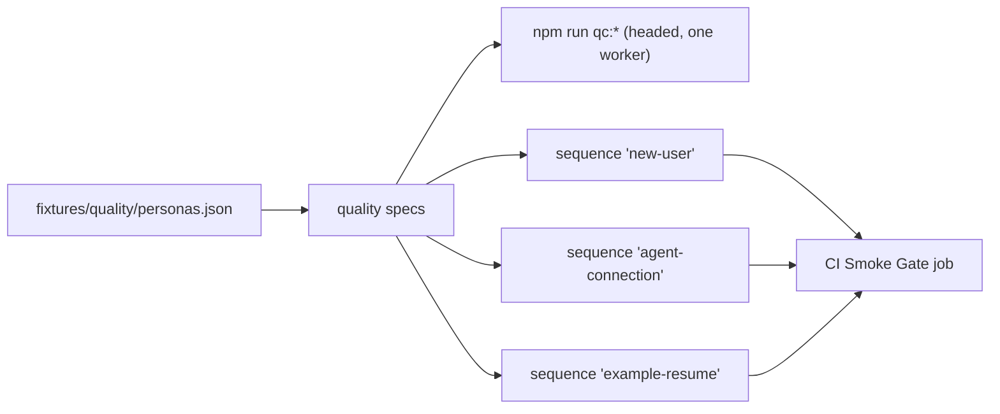

# `tests/e2e/quality/` — headed acceptance of whole tasks

Long, realistic runs of complete tasks, usually watched in a headed browser: a new
user trying every view, personas creating and finishing work, a person handing work
to an AI agent, offline use, signup, feedback and project import/export. Each run
creates and cleans up its own data and checks the saved result independently
through the API, not just the screen. Most specs repeat at phone, landscape-phone
and desktop sizes.



## What's here (grouped by how they run)

| Group | Specs | What they check |
| --- | --- | --- |
| `new-user` sequence (CI) | `new-user-modes`, `button-content`, `persona-lifecycle`, `graph-motion`, `graph-resize`, `graph-details`, `graph-controls`, `visual-style` | Same saved work in all eight views; buttons hold their labels; persona create → progress → return; the graph settles and stays clear of controls; every quick-editor type and status saves; drafts survive; studio visual review. |
| `example-resume` sequence (CI) | `example-resume` | An example project a closed browser left unfinished is finished, once, at the next sign-in in a fresh browser. Its own sequence: it waits out the app's 30 s check that no other browser is still writing the example. |
| `agent-connection` sequence (CI) | `agent-collaboration` | A person creates an agent token, the agent works through the API, and the handoff shows up for the person. |
| `qc:*` scripts only | `graph-first-journey`, `graph-layout`, `modal-header`, `reported-controls`, `signup-delivery`, `turnstile-guest`, `hosted-usage`, `project-transfer` | Build a graph only through its UI; cards don't stack at 12/50/200 nodes; modals stay below the header; account menu, templates, minimap; signup outcomes; Turnstile guest entry; usage-limit warnings; portable project JSON round trip as a guest. |
| Opt-in, need outside fixtures | `real-agent-journey` (`QC_REAL_AGENTS=1`), `operator-login` (`OPERATOR_CREDENTIAL_FILE`), `cloud-agent-connection` (`QC_AGENT_FIXTURE`), `offline-sync`, `operations` | Real Claude/Codex runs (see [`tests/agents/`](../../agents/README.md)); a real operator login; hosted-build agent setup on a local Worker; offline sync and feedback flows that read a fixture file from `/tmp` and call a local sync Worker. |

`graph-details`, `new-user-modes` and `persona-lifecycle` also run against a local
hosted-build backend when `QC_BACKEND=cloud`; they refuse non-local targets.

## How to run

```bash
TEST_URL=http://localhost:3127 npm run qc:new-user      # most of the new-user set, headed
TEST_URL=http://localhost:3127 node tests/run-unified.mjs --sequence new-user
```

Every spec except `cloud-agent-connection` has its own `qc:` script in
`package.json` (for example `qc:personas`, `qc:offline`, `qc:project-transfer`).
The persona scenarios are in [`tests/fixtures/quality/`](../../fixtures/quality/README.md).

Up: [`tests/e2e/`](../README.md)
