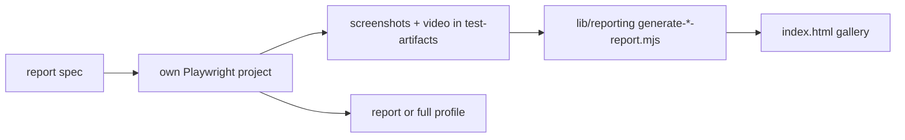

# `tests/e2e/reports/` — capture-heavy report specs

Specs whose main output is evidence to look at: screenshots, `.webm` videos and
galleries. The default Playwright project ignores this folder so the smoke gate
stays fast; each spec has its own project in
[`playwright.config.ts`](../../../playwright.config.ts) and a non-blocking unified
sequence. Gallery builders live in [`tests/lib/reporting/`](../../lib/reporting/README.md).



## What's here

| Path | Project | What it is |
| --- | --- | --- |
| [`feature-matrix.spec.ts`](feature-matrix.spec.ts) | `matrix` | Every view, page and key feature at every resolution, each with a full-page screenshot and the layout/contrast audits. Gallery: `npm run report:matrix`. |
| [`matrix.setup.ts`](matrix.setup.ts) | `matrix-setup` | Signs in once and saves the login so the matrix cells don't sign in again. |
| [`showcase.spec.ts`](showcase.spec.ts) | `showcase` | A tour of every mode of operation at five screen sizes, recorded as video plus step screenshots. `npm run report:showcase`; the CI "Showcase Report" job runs it. |
| [`live-cloud-journey.spec.ts`](live-cloud-journey.spec.ts) | `live-journey` | A guest explores the live hosted site on desktop and phone with video. Uses `TEST_URL` as the site; run with `--profile live`. |
| [`vlm-evaluation.spec.ts`](vlm-evaluation.spec.ts) | `vlm` | Asks a locally hosted vision model to judge key screens from four points of view (defects, new-user clarity, accessibility, liveliness). Skips unless `VLM_ENDPOINTS` is set in `.env.test.local`. `npm run test:vlm`. |
| [`visual-regression.spec.ts`](visual-regression.spec.ts) | none | Screenshots of every screen on 21 device sizes. `npm run test:e2e:visual` names it, but no Playwright project currently matches this file. |
| [`VISUAL_REGRESSION_README.md`](VISUAL_REGRESSION_README.md) | | Older guide to the visual-regression suite's devices and output. |

## How to run

```bash
npm run report:showcase                       # needs a running stack
node tests/run-unified.mjs --profile report   # diagnostics, showcase, matrix, vlm, perf-scale, cloud-audit
```

Up: [`tests/e2e/`](../README.md)
