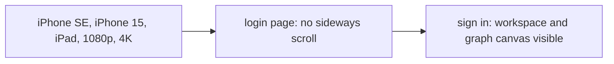

# `tests/e2e/responsive/` — core flow at five screen sizes

The regression net for the responsive work (story RESP-5 in
[`docs/USER_STORIES.md`](../../../docs/USER_STORIES.md)): the login page and the
workspace must work on phone, tablet and desktop with no sideways scroll.

## What's here

| Path | What it is |
| --- | --- |
| [`viewports.spec.ts`](viewports.spec.ts) | For each of five viewports: the login page renders without horizontal scroll (`@core`), and after login the workspace and graph canvas are visible. |

## How to run

Collected by the default Playwright project (`npm run test:e2e`).
`npm run test:e2e:core` runs the `@core` login cases. For every control on every
screen per device, see the [UI fit gate](../../devices/README.md).

Up: [`tests/e2e/`](../README.md)
