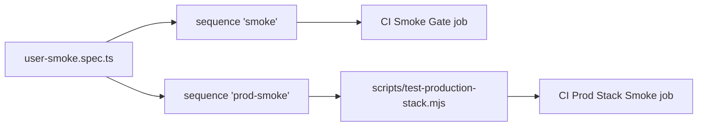

# `tests/e2e/smoke/` — the smoke gate

`user-smoke.spec.ts` is "the gate": the honest check that a real user can sign in
and use the graph. It must pass before anyone claims the app works. It is in the `smoke`,
`pr` and `full` unified profiles, the CI "Smoke Gate" job runs it on every push and
pull request, and the CI "Prod Stack Smoke" job runs it against a freshly built
production stack (on `main`, PRs into `main`, and the nightly schedule).



## What's here

| Path | What it is |
| --- | --- |
| [`user-smoke.spec.ts`](user-smoke.spec.ts) | Six `@smoke` cases on a small seeded graph: nodes and edges render with no errors; the + grow flow makes a connected, named node; a new empty graph shows the empty state; no orphan edges in the database; a moved node survives reload; a failed layout save keeps the latest drag through navigation and reload. |
| [`basic-workflow.spec.ts`](basic-workflow.spec.ts) | An older end-to-end walk: sign in, pick or create a graph, create a node, see it appear without a refresh. Only the default project runs it. |

## How to run

```bash
TEST_URL=http://localhost:3127 npm run test:smoke          # the gate alone
TEST_URL=http://localhost:3127 npm run test:unified:smoke  # gate + web unit + auth focus
```

For the production-stack version, see [Testing](../../../docs/testing/README.md).

Up: [`tests/e2e/`](../README.md)
