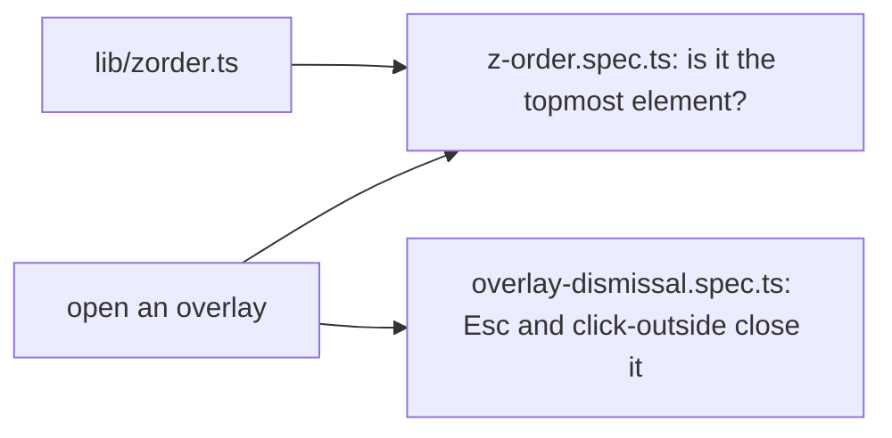

# `tests/e2e/ui/` — overlays: closing and stacking

Checks that every dropdown, modal, menu and toast behaves: it closes with Escape or
a click outside, and it is really painted on top of everything else. The z-order
spec asks the browser which element is at a point inside the overlay
(`document.elementFromPoint`), which catches overlays trapped behind the nav or a
panel by a parent's stacking context.

## What's here

| Path | What it is |
| --- | --- |
| [`overlay-dismissal.spec.ts`](overlay-dismissal.spec.ts) | Details, create-item and create-graph modals close on Escape or backdrop click; pickers inside the details modal take Escape without losing a draft; graph-selector, user-menu and quality dropdowns close on click-outside. `@dismissal` |
| [`z-order.spec.ts`](z-order.spec.ts) | Per viewport: dropdowns, filter menus, details and create modals, toasts over modals, dropdowns inside modals, the node peek and context menu, ontology/settings/admin dialogs and the phone "More" sheet are all on top. `@zorder` |

## How to run

Collected by the default Playwright project (`npm run test:e2e`). No unified
sequence or CI step names these files. Keyboard focus inside modals is covered by
[`e2e/a11y/`](../a11y/README.md).

Up: [`tests/e2e/`](../README.md)
