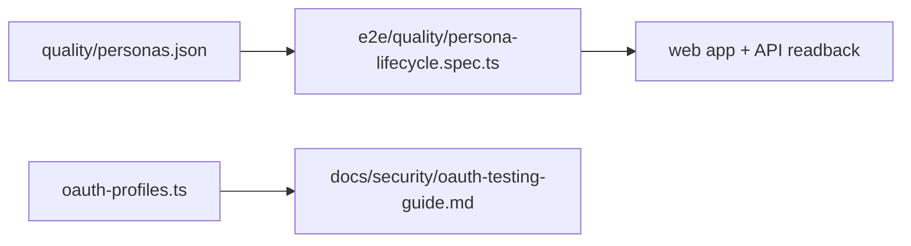

# `tests/fixtures/` — static test data

Fixed data files that tests read instead of building inputs inline: persona
scenarios for the quality runs and mock OAuth provider responses.

## What's here

| Path | What it is |
| --- | --- |
| [`quality/`](quality/README.md) | Six persona scenarios (household, student, solo engineer, small/large/research team) that the persona acceptance run executes. |
| [`oauth-profiles.ts`](oauth-profiles.ts) | Mock Google, GitHub and LinkedIn responses: profiles, tokens, emails, LinkedIn OpenID config, test users, error and state cases, scopes. Described in the [OAuth testing guide](../../docs/security/oauth-testing-guide.md); no spec in this repo imports it at the moment. |

Data that a test creates at run time (graphs, items) is made through helpers in
[`tests/lib/`](../lib/README.md) and deleted afterwards, not stored here.

Up: [`tests/`](../README.md)
