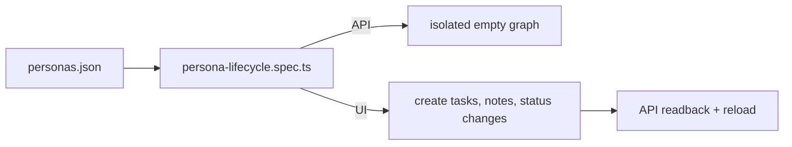

# `tests/fixtures/quality/` — persona scenarios

Machine-readable, single-person scenarios for the quality acceptance runs. The
human-readable description and its limits are in
[`docs/quality/SCENARIOS.md`](../../../docs/quality/SCENARIOS.md).

## What's here

| Path | What it is |
| --- | --- |
| [`personas.json`](personas.json) | Six scenarios: `HOME-01` household planning, `STUDENT-01` student project, `SOLO-01` solo engineering, `TEAM-01` small team, `LARGE-01` large team, `RESEARCH-01` research team. Each has an actor, team size, goal, preconditions, viewport, input, steps, scope and automation notes. |

## How to run

[`e2e/quality/persona-lifecycle.spec.ts`](../../e2e/quality/README.md) makes one
test per scenario. Run it headed with `npm run qc:personas`, or as part of the
`new-user` unified sequence. These are single-person checks, not evidence of
multi-user collaboration or scale.

Up: [`tests/fixtures/`](../README.md)
