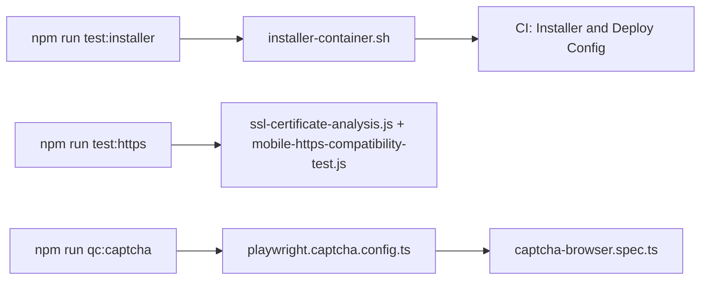

# `tests/integration/` — installer, TLS and captcha checks

Checks of infrastructure around the app rather than its screens: the one-line
installer, HTTPS certificates, and server-side captcha in a production-mode build.
The default Playwright project does not look in this folder; each check has its own
entry point.



## What's here

| Path | What it is |
| --- | --- |
| [`installer-container.sh`](installer-container.sh) | Runs `scripts/install.sh` in a throwaway container up to the code download: a fresh install clones `GRAPHDONE_REF` (default `main`), a re-run updates in place, an install stuck on a deleted branch moves to the ref, and every setup-script fallback URL answers 200. Needs Docker. |
| [`captcha-browser.spec.ts`](captcha-browser.spec.ts) | Against an owned production-mode Core: REST and GraphQL reject missing or forged captcha proof, and pending, failed or expired verification cannot submit a password. Needs `CAPTCHA_OWNED_TARGET=1` and `CAPTCHA_TEST_PASSWORD`. |
| [`playwright.captcha.config.ts`](playwright.captcha.config.ts) | Single-purpose config for the captcha spec: one worker, no retries, output in `test-artifacts/captcha-browser/`. |
| [`ssl-certificate-analysis.js`](ssl-certificate-analysis.js) | Standalone Node script: how Chromium, Firefox and WebKit treat the dev self-signed certificate on `https://localhost:3128`. |
| [`mobile-https-compatibility-test.js`](mobile-https-compatibility-test.js) | Standalone Node script: phone browser profiles against the same HTTPS dev server. |
| [`installation-validation.spec.ts`](installation-validation.spec.ts) | Playwright spec for the installer across Linux distributions. No Playwright project or script runs it today. |
| [`tls-integration.spec.ts`](tls-integration.spec.ts) | Playwright spec for HTTPS, WSS, certificates and security headers. No Playwright project or script runs it today. |

## How to run

```bash
npm run test:installer   # installer contract (tests/toolchain) + installer-container.sh
npm run test:https       # the two standalone HTTPS scripts
```

The CI "Comprehensive Test Suite" workflow runs the installer checks in its
"Installer & Deploy Config" job. The installer's static contract is in
[`tests/toolchain/`](../toolchain/README.md).

Up: [`tests/`](../README.md)
