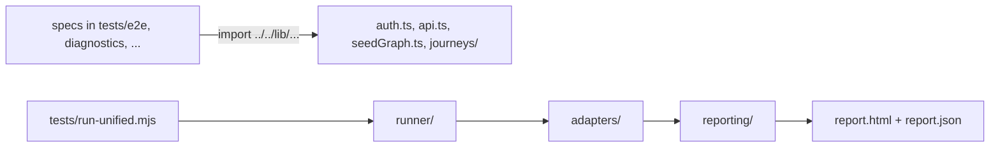

# `tests/lib/` — reusable test layer + unified harness

Everything reusable across the test suite lives here. Specs import from it via
`../../lib/<module>` (specs sit in depth-2 domain folders like `tests/e2e/auth/`).

## Helpers (consumed by specs)
- `auth.ts` — battle-tested `login` / `navigateToWorkspace` / `TEST_USERS` (the
  foundation for every authenticated E2E spec)
- `api.ts` — GraphQL/REST helpers that authenticate the way the UI does
- `seedGraph.ts` — seed graphs/work items for a test
- `dbHealing.ts` — DB isolation + cleanup for heavy suites
- `testEnv.ts` — `.env.test.local` loader (VLM endpoints, etc.)
- `mobileAudit.ts`, `zorder.ts` — DOM auditors used by the mobile/z-order specs
- `edgeLabelAudit.ts` — reads every drawn relationship label's box from the DOM
  and says whether it is readable (shown, clear of cards and labels, in its gap)
- `vlm.ts` — local-VLM client for the visual-evaluation sequence
- `mock-oauth-server.ts` — OAuth mock for the admin/oauth-provider specs
- `metrics/balance_metrics.py` — OpenCV graph-balance metrics (subprocess; also
  referenced by the GraphDone-Cloud live-audit via the `core/` submodule)

## Unified harness (`npm run test:unified`)
The single, reproducible entry (`tests/run-unified.mjs`) runs a profile of
sequences from `tests/sequences/unified.config.mjs` and emits DUAL output to
`test-artifacts/unified/`: `report.html` (per-sequence pass/warn/fail with embedded
`` screenshots + `<video>` .webm clips) and `report.json`
(`schema: graphdone.unified-report/1`). Exit code = rollup status (CI-gateable).

- `reporting/` — `aggregate.mjs` (pure rollup, `node --test`), `html.mjs`, `json.mjs`,
  and the consolidated `generate-*-report.mjs` domain generators
- `adapters/` — normalise external results into unified sequences:
  `playwright.mjs` (parses PW JSON + harvests video/screenshots), `vitest.mjs`,
  `cloud-audit.mjs` (ingests the sibling GraphDone-Cloud live-audit findings.json)
- `runner/runSequence.mjs` — argv-array spawn that captures exit/stdout/duration

Profiles: `smoke` (fast blocking) · `pr` (broader blocking) · `full` (everything
incl. capture-heavy report sequences + cloud audit) · `report` (captures only).

## Subfolders

| Folder | What it holds |
| --- | --- |
| [`reporting/`](reporting/README.md) | The unified report: rollup, HTML and JSON writers, reliability statistics, galleries |
| [`adapters/`](adapters/README.md) | Turn Playwright, Vitest and other runs into unified sequences |
| [`runner/`](runner/README.md) | Process, output and source-provenance safety for the harness |
| [`journeys/`](journeys/README.md) | Building blocks for the basic-journey suite (workspace setup, connect paths) |
| [`ui-fit/`](ui-fit/README.md) | Measuring and rules for the UI fit gate |
| [`perf/`](perf/README.md) | Evidence rules for the performance gate |
| [`metrics/`](metrics/README.md) | Image metrics for graph layout (OpenCV balance) |
| [`production/`](production/README.md) | Helpers for the production-stack smoke |
| [`release/`](release/README.md) | Release and workflow guards |
| [`dependencies/`](dependencies/README.md) | Dependency security guards |
| [`dashboard/`](dashboard/README.md) | The live test dashboard |

Run the lib's own unit tests with `npm run test:unified:lib` (`node --test "tests/lib/**/*.test.mjs"`).

Up: [`tests/`](../README.md)
