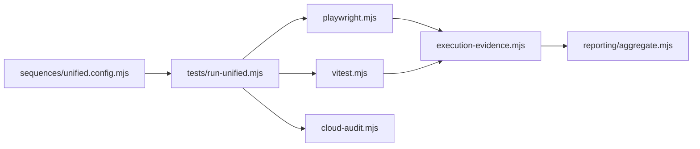

# `tests/lib/adapters/` — turn test runs into unified sequences

The unified harness runs very different tools (Vitest, Playwright, a findings file
from the hosted build's live audit). An adapter runs one of them and turns its
output into the same sequence shape: counts, cases, attachments and a status. The
adapters are strict on purpose: a missing, empty, malformed or contradictory report
can never become a pass.

## What's here

| Path | What it is |
| --- | --- |
| [`playwright.mjs`](playwright.mjs) | `runPlaywrightSequence`: runs Playwright with a JSON reporter, reads per-case results, and collects screenshots, videos, traces and JSON attachments (only from inside `test-artifacts/`). |
| [`vitest.mjs`](vitest.mjs) | `runVitestSequence`: runs `npx vitest run --reporter=json` in a package folder and counts only assertions that actually passed. |
| [`cloud-audit.mjs`](cloud-audit.mjs) | Finds the newest live-audit `findings.json` from the hosted build's repository checked out beside this one, and maps pass/warn/fail/info to a sequence. Skips cleanly when there is none. |
| [`execution-evidence.mjs`](execution-evidence.mjs) | Shared final checks: timeout, nonzero exit, process error, no executed results, or skipped required cases all fail the sequence; summary counters must agree with the cases. |
| [`execution-evidence.test.mjs`](execution-evidence.test.mjs) | Runs fake child processes that write passing, empty, malformed, skipped and flaky reports and checks none of them fake a pass. |
| [`cloud-audit.test.mjs`](cloud-audit.test.mjs) | Status mapping, failure, and missing-file cases for the cloud-audit adapter. |

## How to run

`npm run test:unified:lib` runs these tests with every other `tests/lib/**/*.test.mjs`
file; CI runs it in the "Lint & Type Check" job. The rules they enforce are written
up in [Testing](../../../docs/testing/README.md#dual-output-one-run-two-artifacts).

Up: [`tests/lib/`](../README.md)
