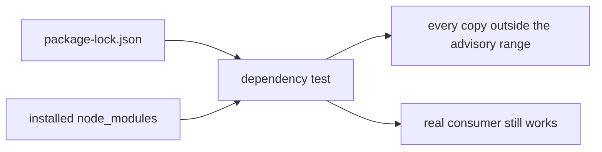

# `tests/lib/dependencies/` — dependency security guards

Each file pins down a dependency security fix so it cannot quietly come back. They
check two things: every copy of the package in `package-lock.json` is on a fixed
release, and the code that really uses the package still works with the installed
copy. Most were added while closing a specific security advisory.



## What's here

| Path | What it guards |
| --- | --- |
| [`hono-static.test.mjs`](hono-static.test.mjs) | Hono and the MCP SDK's static-file adapter: fixed releases, access checks and encoded file names still work, and the server schema gets `DateTime` without an extra scalar package. |
| [`minimatch.test.mjs`](minimatch.test.mjs) | The lint parser's glob matcher stays fast on nested patterns and still picks the right source files. |
| [`router.test.mjs`](router.test.mjs) | Every locked React Router copy has the 7.18 security fixes. |
| [`selector-parser.test.mjs`](selector-parser.test.mjs) | Tailwind's CSS selector parser is a fixed release and still builds flat, nested and responsive styles. |
| [`sucrase.test.mjs`](sucrase.test.mjs) | Tailwind's config loader uses a sucrase release without the affected glob/minimatch copies, and still loads configs. |
| [`toolchain.test.mjs`](toolchain.test.mjs) | Vite, Vitest, coverage, the React plugin and esbuild are on the reviewed patched lines; no legacy Vitest worker or vite-node remains. |
| [`undici.test.mjs`](undici.test.mjs) | Every Undici copy, including the one used by SQLite's native build, excludes the October 2026 advisories. |
| [`uuid.test.mjs`](uuid.test.mjs) | Every UUID copy has the buffer fix, and Core plus the Apollo federation schema build still work with it. |

## How to run

```bash
npm run test:unified:lib                                  # with all tests/lib tests
node --test tests/lib/dependencies/uuid.test.mjs          # one guard
```

They need `npm ci` to have run, because they read installed packages. CI runs
them through `npm run test:unified:lib`.

Up: [`tests/lib/`](../README.md)
