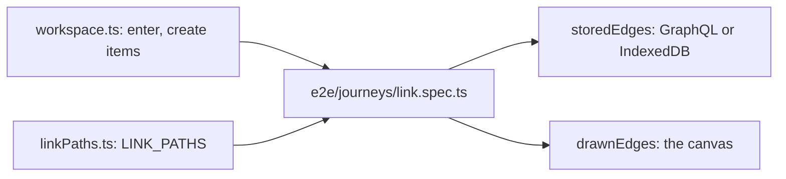

# `tests/lib/journeys/` — basic journey building blocks

Shared code for the basic user journeys in
[`tests/e2e/journeys/`](../../e2e/journeys/README.md). It drives the app like a
person (real pointer, touch and pinch events at what is on screen, no forced clicks,
no retry-until-pass) and reads the saved truth from wherever the backend keeps it.

## What's here

| Path | What it is |
| --- | --- |
| [`workspace.ts`](workspace.ts) | `enterWorkspace` (sign in and create a new graph, or "Continue as Guest" when `JOURNEY_BACKEND=hosted-guest`), `createItem` with the toolbar control, `storedEdges` (GraphQL for self-host, the `graphdone-offline` IndexedDB for a guest), `drawnEdges`, `cardBox`, `clickable`, and `SetupError` (messages start with `SETUP:` so reports keep setup failures apart). |
| [`linkPaths.ts`](linkPaths.ts) | `LINK_PATHS`: every way to connect two items — + then click, inspector Connect, Shift-click, Alt-drag, the card menu, quick edit "Details & connections". Each path returns its friction (zoom-in, zoom-out and pan steps). Helpers tap on touch and click on desktop, long-press, pinch or wheel to zoom, and pan items into view. |

## Adding a path or a journey

Add an entry to `LINK_PATHS` (mark it `desktopOnly` if it needs a keyboard
modifier) and it becomes a new test in all three journeys projects. A new journey
is a new `*.spec.ts` file in `tests/e2e/journeys/`: the journeys projects match
every spec there, and repeated cases get the same success-rate rollup in the
unified report.

Up: [`tests/lib/`](../README.md)
