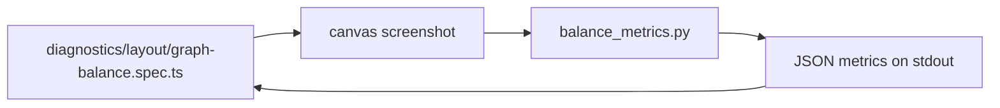

# `tests/lib/metrics/` — image metrics for graph layout

A Python script that measures how a graph sits on screen from a screenshot, using
OpenCV. It reports numbers, not verdicts: the caller decides the pass/fail
thresholds.



## What's here

| Path | What it is |
| --- | --- |
| [`balance_metrics.py`](balance_metrics.py) | Separates the drawn graph from the background by edge density, then reports centroid offset from the centre, bounding-box coverage, content usage, left/right and top/bottom margin balance, quadrant mass and an informational `balanceScore` (0–100). |

## How to run

```bash
python3 tests/lib/metrics/balance_metrics.py <image> [--annotate <out.jpg>]
```

Needs Python 3 with `opencv-python` (`cv2`) and `numpy`. In this repo it is called
by [`tests/diagnostics/layout/`](../../diagnostics/layout/README.md); the hosted
build's live audit also uses it.

Up: [`tests/lib/`](../README.md)
