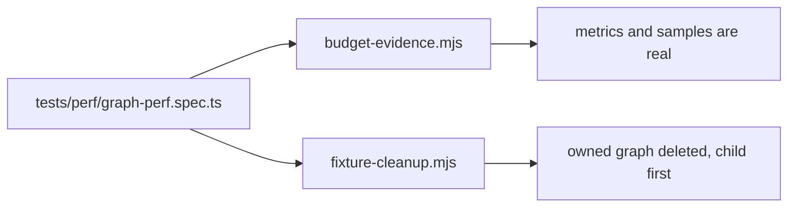

# `tests/lib/perf/` — evidence rules for the performance gate

Small, pure helpers that decide whether the performance gate measured what it
claims to. They exist because an earlier gate could pass on empty graphs, missing
metrics or failed requests. Used by
[`tests/perf/graph-perf.spec.ts`](../../perf/README.md); unit-tested without a browser.

## What's here

| Path | What it is |
| --- | --- |
| [`budget-evidence.mjs`](budget-evidence.mjs) | `requirePerfMetrics` (the in-app meter measured the selected owned graph, settled, with every node and edge and real tick samples), `requireWorkItemSample` (each timed response returned exactly the owned items), `sampleP95` (needs all 20 samples; takes the conservative percentile). |
| [`fixture-cleanup.mjs`](fixture-cleanup.mjs) | `cleanupPerfGraph`: deletes edges, then work items, then the graph, and fails if any count is not the expected one, so nothing is left detached. |
| [`budget-evidence.test.mjs`](budget-evidence.test.mjs) | Accepts real measurements and rejects each kind of missing or wrong evidence. |
| [`fixture-cleanup.test.mjs`](fixture-cleanup.test.mjs) | Order, graph scoping, and failure at each stage keeping the remaining ownership path. |

## How to run

`npm run test:unified:lib` (CI "Lint & Type Check" job). Budgets and what the gate
does not prove are in [Testing](../../../docs/testing/README.md).

Up: [`tests/lib/`](../README.md)
