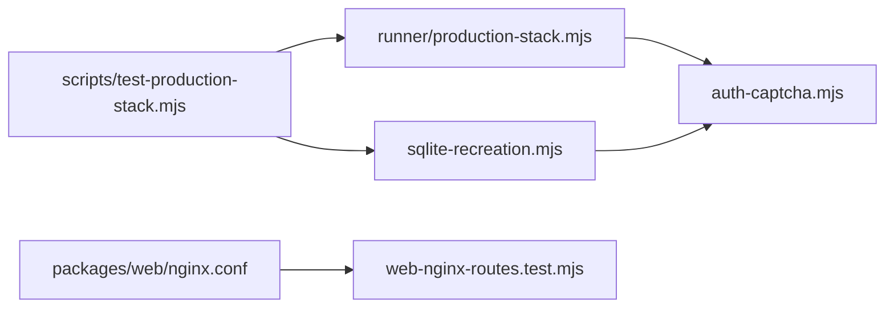

# `tests/lib/production/` — production-stack test helpers

Helpers for testing a real production build, where sign-in needs a server-issued
captcha proof and data lives in a SQLite volume. They are used by the disposable
production-stack runner (`scripts/test-production-stack.mjs`, CI job
"Prod Stack Smoke") through [`tests/lib/runner/`](../runner/README.md).

## What's here

| Path | What it is |
| --- | --- |
| [`auth-captcha.mjs`](auth-captcha.mjs) | `productionLoginProof`: fetches a login challenge from `/api/captcha/challenge`, checks it is well formed and bounded, solves it, and returns the proof. |
| [`sqlite-recreation.mjs`](sqlite-recreation.mjs) | `verifySqliteRecreation`: signs in, recreates the API container, signs in again, and requires the same account identity, so a freshly bootstrapped replacement account cannot pass. |
| [`web-nginx-routes.test.mjs`](web-nginx-routes.test.mjs) | Reads the production nginx config: `/api/graphql` maps to the server with WebSocket upgrade, `/api` prefixes are kept, auth and config paths reach the API, app routes stay in the SPA. |
| `auth-captcha.test.mjs`, `sqlite-recreation.test.mjs` | Unit tests with fake requests: valid, invalid, oversized and unsolvable challenges; identity, GraphQL-error and failed-recreation cases. |

## How to run

`npm run test:unified:lib` runs the unit tests. The full production run is
described under "Disposable production stack" in
[Testing](../../../docs/testing/README.md).

Up: [`tests/lib/`](../README.md)
