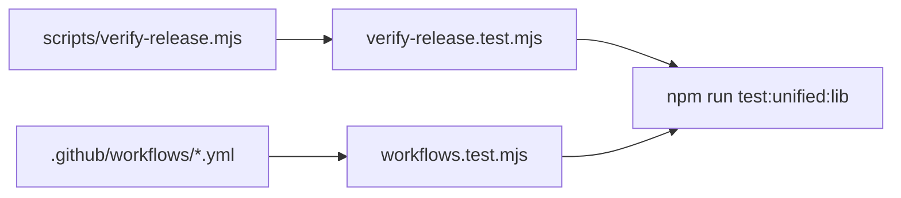

# `tests/lib/release/` — release and workflow guards

Tests that keep releases and CI safe. They check the release verifier script and
read the GitHub workflow files directly, so a workflow edit that would publish from
an unverified commit or let a required job be skipped fails here first.

## What's here

| Path | What it is |
| --- | --- |
| [`verify-release.test.mjs`](verify-release.test.mjs) | Tests [`scripts/verify-release.mjs`](../../../scripts/verify-release.mjs): tag format, semver order, every manifest carries the tag version, all required checks passed (the newest run decides), "latest" handling, and only main-line commits count. Also runs the CLI against throwaway Git repositories. |
| [`workflows.test.mjs`](workflows.test.mjs) | Docker validation builds cannot push; there is no deploy workflow (graphdone.com deploys from the hosted build's repository); releases run only for version tags, after the source gate, from the verified commit; every required job (including UI fit) can fail CI; public artifacts exclude raw browser traces. |

## How to run

`npm run test:unified:lib`, which CI runs in the "Lint & Type Check" job. The
release workflow itself is [`.github/workflows/release.yml`](../../../.github/workflows/release.yml).

Up: [`tests/lib/`](../README.md)
