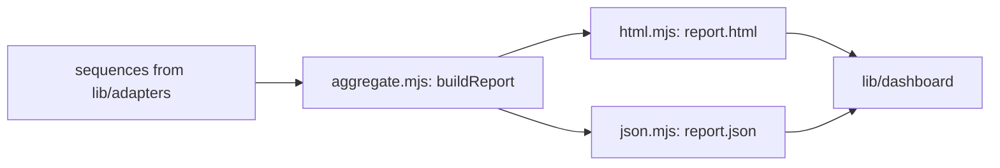

# `tests/lib/reporting/` — unified report and galleries

Turns sequence results into the unified report (`report.html` and `report.json` in
`test-artifacts/unified/`) and builds the stand-alone galleries for the
capture-heavy projects. The rollup is pure code with no file access, so it is unit
tested directly.

## What's here

| Path | What it is |
| --- | --- |
| [`aggregate.mjs`](aggregate.mjs) | `buildReport`, worst-of status rollup (failed > warn > passed > skipped), totals, and section refs such as `3.2`. For sequences that repeat cases it adds `reliability`: per path and device, passes out of trials, the rate and its 95% Wilson lower bound (`wilsonLower`). Failures whose error starts with `SETUP:` are counted apart; skips are not trials. |
| [`html.mjs`](html.mjs) | `renderHtml`: one self-contained page with per-sequence status, embedded screenshots and `.webm` videos, download links, and the reliability table ("At least (95%)"). |
| [`json.mjs`](json.mjs) | `writeJsonReport`: `report.json` (schema `graphdone.unified-report/1`) plus one JSON per sequence under `sequences/`. |
| [`aggregate.test.mjs`](aggregate.test.mjs) | Rollup, refs, Wilson bound (30 of 30 gives about 89%) and reliability grouping. |
| [`generate-matrix-report.mjs`](generate-matrix-report.mjs) | Gallery for the feature × resolution matrix: `test-artifacts/matrix/index.html`. |
| [`generate-showcase-report.mjs`](generate-showcase-report.mjs) | Gallery of showcase videos and step screenshots: `test-artifacts/showcase/index.html`. |
| [`generate-perf-report.mjs`](generate-perf-report.mjs) | Table and SVG charts for the scale sweep: `test-artifacts/scale-sweep/index.html`. |
| [`generate-vlm-report.mjs`](generate-vlm-report.mjs) | Gallery of vision-model verdicts: `test-artifacts/vlm/index.html`. |

## How to run

The report is written by every `node tests/run-unified.mjs` run. The galleries run
from `npm run report:matrix`, `report:showcase`, `report:perf` and `report:vlm`.
`npm run test:unified:lib` runs `aggregate.test.mjs`. The live view of these
reports is [`tests/lib/dashboard/`](../dashboard/README.md).

Up: [`tests/lib/`](../README.md)
