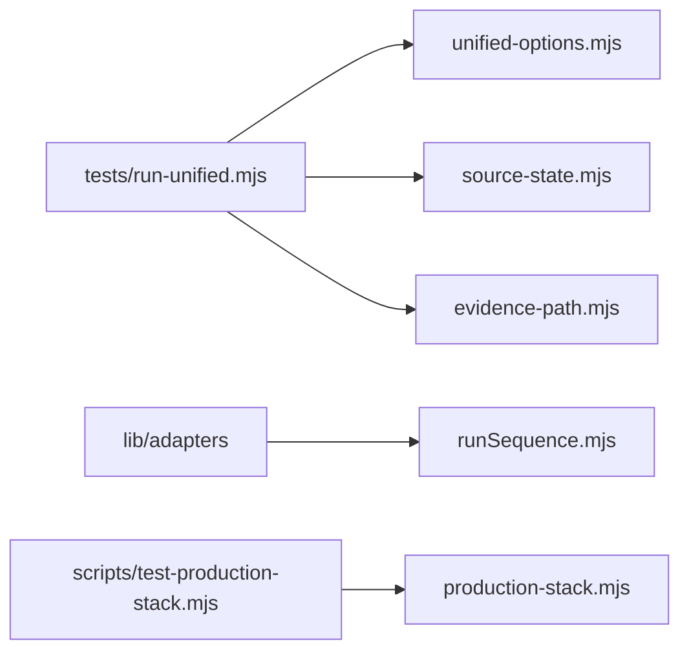

# `tests/lib/runner/` — process, output and provenance safety

The parts of the unified harness that start processes and decide where evidence
may be written. They make sure a timed-out test cannot leave stray processes, a
report cannot overwrite source files, and every report says exactly which source
it tested. The tests use real, disposable processes and Git repositories rather
than mocks.

## What's here

| Path | What it is |
| --- | --- |
| [`runSequence.mjs`](runSequence.mjs) | `runCommand`: spawns an argv array (no shell) in its own process group, captures output and duration, and on timeout or Ctrl-C stops the whole group (SIGTERM, then SIGKILL). |
| [`unified-options.mjs`](unified-options.mjs) | Parses `--profile`, `--sequence`, `--out`, `--open`, `--cloud-findings`; `prepareOutput` refuses the repo root, Git folders, symlinks and unrelated non-empty folders. |
| [`source-state.mjs`](source-state.mjs) | Git revision, dirty flag and a SHA-256 fingerprint of tracked and untracked source, so a change during the run is caught. |
| [`evidence-path.mjs`](evidence-path.mjs) | Only regular files inside `test-artifacts/` (no symlinks) may be attached as evidence. |
| [`browser-diagnostics.mjs`](browser-diagnostics.mjs) | Collects the last 50 console errors, page errors and failed requests for a failure report, with credentials and URL queries removed. Used by `button-content.spec.ts`. |
| [`production-stack.mjs`](production-stack.mjs) | Health checks, isolated Compose project, local-only TLS requests, owned seed data and staged run for the disposable production stack. |
| `*.test.mjs` | `runSequence`, `unified-cli` (selection, output safety, provenance), `browser-diagnostics`, `production-stack`, and `owned-graph-fixture` (cleanup of the shared `ownedGraphIdsFixture` stays strict). |

## How to run

`npm run test:unified:lib` (CI "Lint & Type Check" job). Timeout and cleanup
behaviour is documented in [Testing](../../../docs/testing/README.md).

Up: [`tests/lib/`](../README.md)
