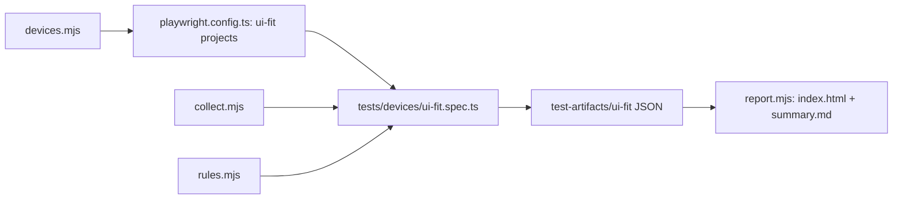

# `tests/lib/ui-fit/` — UI fit measuring and rules

The engine behind the [UI fit gate](../../devices/README.md): which devices to use,
how to measure every control in the browser, which measurements are problems, and
the review gallery. The rules are pure functions so they are unit tested without a
browser.

## What's here

| Path | What it is |
| --- | --- |
| [`devices.mjs`](devices.mjs) | `UI_FIT_DEVICES` (desktop Chrome and Safari at 1440×900, iPad Pro 11 and iPhone 15 in portrait and landscape; Apple devices use WebKit) and `uiFitProjects()` for the Playwright config. |
| [`collect.mjs`](collect.mjs) | Runs in the page: finds every visible interactive control and measures its box, hit point, name, icon, text overflow and colours; also measures pixels for contrast and icon centring. |
| [`rules.mjs`](rules.mjs) | Turns measurements into findings: 24 px minimum target (WCAG 2.5.8), 44 px touch comfort (reported, not gated), icon centring within 0.75 px, contrast, sideways scroll and more. `applyExemptions` uses `tests/devices/ui-fit-exemptions.json`. |
| [`rules.test.mjs`](rules.test.mjs) | One test per rule with hand-built controls. |
| [`report.mjs`](report.mjs) | `node tests/lib/ui-fit/report.mjs [test-artifacts/ui-fit]`: writes `index.html` (annotated screenshots per screen and device) and `summary.md` for the CI job summary. |

## How to run

`npm run test:devices` runs the gate and then `report.mjs`. `npm run test:unified:lib`
runs `rules.test.mjs`. The rules are explained in the
[UI fit guide](../../../docs/quality/UI_FIT.md).

Up: [`tests/lib/`](../README.md)
