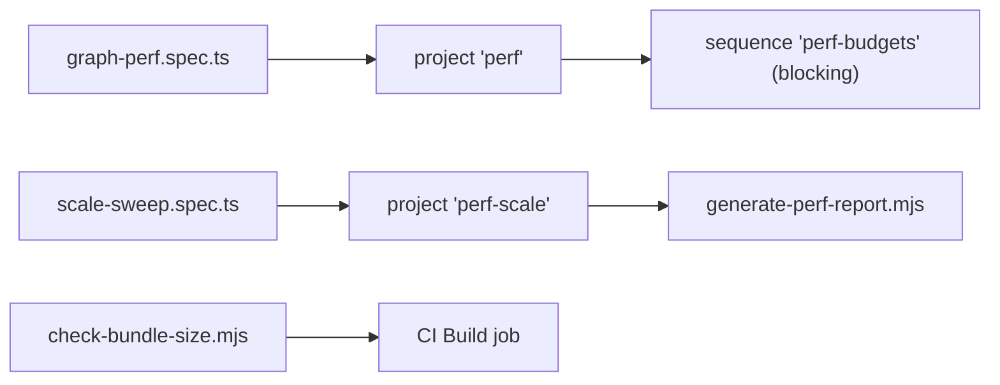

# `tests/perf/` — performance budgets and scale sweep

Performance checks for user story ADAPT-8. Two Playwright projects use this folder:
`perf` (the blocking budget gate, which skips the sweep) and `perf-scale` (the
report-only sweep). A separate Node script checks the built bundle size.



## What's here

| Path | What it is |
| --- | --- |
| [`graph-perf.spec.ts`](graph-perf.spec.ts) | The budget gate. Each case creates its own four-item, three-connection placed graph and checks: settles within 12 s with alpha ≤ 0.02 and average tick ≤ 8 ms; stays within 25 px of its saved positions; `workItems` query p95 ≤ 800 ms over 20 samples. Evidence rules come from [`tests/lib/perf/`](../lib/perf/README.md). `@perf` |
| [`scale-sweep.spec.ts`](scale-sweep.spec.ts) | Seeds graphs of growing size (default 50 to 2000 items locally, 40 and 120 in CI) and records the in-app performance readings per quality tier into `test-artifacts/scale-sweep/`. Only fails if a seeded graph does not render. Sizes come from `SCALE_SWEEP_SIZES` / `SCALE_SWEEP_QUALITIES`. |
| [`check-bundle-size.mjs`](check-bundle-size.mjs) | Fails if the largest gzipped JS chunk in `packages/web/dist/assets` is over 450 KB. Run after a build. |

## How to run

```bash
TEST_URL=http://localhost:3127 npm run test:perf            # budget gate
TEST_URL=http://localhost:3127 npm run test:perf:scale      # sweep + HTML report
npm run build && npm run perf:bundle                        # bundle budget
```

The `perf-budgets` sequence is in the `pr` and `full` profiles and the CI Smoke
Gate job; `perf-scale` is in `full` and `report`. What the small gate fixture does
and does not prove is spelled out in [Testing](../../docs/testing/README.md).

Up: [`tests/`](../README.md)
