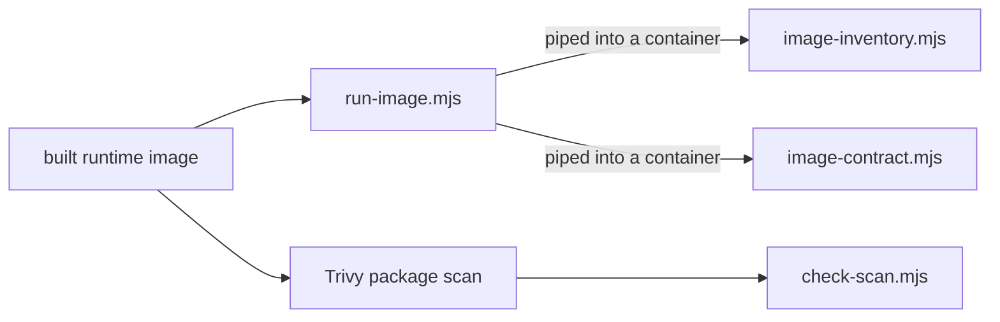

# `tests/runtime/` — production image contract

Checks the final Docker runtime images the way they are shipped. CI builds each
image (API, generic and self-host) and runs `run-image.mjs` on it in the
"Runtime Images" job, with a disposable Neo4j service.

## What's here

| Path | What it is |
| --- | --- |
| [`run-image.mjs`](run-image.mjs) | Host-side driver: `node tests/runtime/run-image.mjs IMAGE EXPECTED_UID [BASELINE_IMAGE_ID]`. Checks the image's command, working folder and production mode, that it refuses to start without its secrets, runs the inventory, then runs the contract on one data volume in an initial and a replacement container (plus upgrade and rollback stages when a baseline image is given). Removes every container and volume it created. |
| [`image-inventory.mjs`](image-inventory.mjs) | Runs inside the image: production mode, expected user, native SQLite loads, and no build or test tools (Vite, Vitest, TypeScript, Playwright, ESLint and so on) installed. |
| [`image-contract.mjs`](image-contract.mjs) | Runs inside the image: refuses weak production secrets, starts the server, uses GraphQL and the MCP server against the disposable Neo4j, and checks that data and sign-in survive a container replacement. |
| [`check-scan.mjs`](check-scan.mjs) | Reads a Trivy JSON scan and asserts it covered both OS and npm packages, then prints the finding counts by severity. |

All scripts require `GRAPHDONE_DISPOSABLE_NEO4J=1` and a local Neo4j address, so
they cannot touch a real database. See the `runtime-images` job in
[`.github/workflows/ci.yml`](../../.github/workflows/ci.yml) for the exact steps.

Up: [`tests/`](../README.md)
