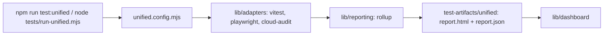

# `tests/sequences/` — unified harness manifest

The single list of everything the unified test harness can run. `tests/run-unified.mjs`
reads `SEQUENCES` and `PROFILES` from here, runs each chosen sequence through an
adapter, and writes one combined report. CI steps call sequences by name, so this
file is where a test becomes part of a gate.



## What's here

| Path | What it is |
| --- | --- |
| [`unified.config.mjs`](unified.config.mjs) | `SEQUENCES`: each entry names an adapter, a title, its inputs (Playwright arguments or a package folder) and whether it is `blocking`. `PROFILES`: named lists of sequences. |

## Profiles

| Profile | npm script | What it runs |
| --- | --- | --- |
| `smoke` | `npm run test:unified:smoke` | Web unit tests, the smoke gate, passwordless sign-in focus. |
| `pr` | `npm run test:pr` | `smoke` plus the graph, agent, inspector, level-of-detail, wire, large-graph, schematic, layout-recovery, routing, mobile, UI fit, performance-budget and zoom-out sequences. All blocking. |
| `full` | `npm run test:unified` | `pr` plus the report-only diagnostics, showcase, matrix, VLM, scale sweep and cloud-audit sequences. |
| `report` | none | Only the report-only capture sequences. |
| `live` | none | The guest journey on the live hosted site (`live-journey`). |
| `journeys` | none | Basic user journeys with success rates ([`e2e/journeys/`](../e2e/journeys/README.md)). |

`new-user`, `example-resume` and `prod-smoke` are in no profile: CI runs
`new-user` and `example-resume` by name, and
`scripts/test-production-stack.mjs` runs `prod-smoke`.

## How to use

```bash
TEST_URL=http://localhost:3127 node tests/run-unified.mjs --sequence mobile --out test-artifacts/runs/mobile-check
node tests/run-unified.mjs --profile journeys
```

To add a test to a gate, add a sequence entry and list it in the right profile;
blocking sequences belong in `smoke` or `pr`. The harness itself (adapters,
runner, reporting) is described in [`tests/lib/`](../lib/README.md) and the full
guide is [Testing](../../docs/testing/README.md).

Up: [`tests/`](../README.md)
