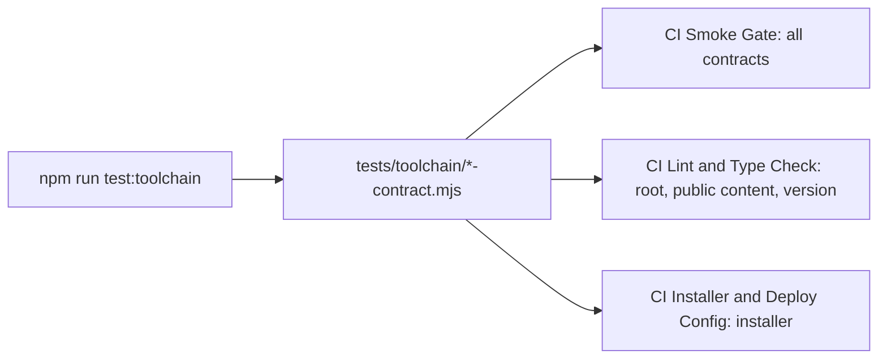

# `tests/toolchain/` — repository and tool contracts

`node:test` contracts that check the repository itself and the installed build
tools, not the app's features. They catch things like a stray file at the repo
root, a private path in a public file, a missed version bump, or a tool upgrade
that quietly changes behaviour.



## What's here

| Path | What it is |
| --- | --- |
| [`repo-root-contract.mjs`](repo-root-contract.mjs) | The repository root holds only allowlisted entries; the list may only shrink. |
| [`public-content-contract.mjs`](public-content-contract.mjs) | Tracked files contain no private repository paths, home directories or private-network addresses. |
| [`version-contract.mjs`](version-contract.mjs) | Every workspace manifest, the lockfile and the runtime-reported versions, image tags and README badge carry the root version. `scripts/update-version-minimal.sh` updates them all. |
| [`installer-contract.mjs`](installer-contract.mjs) | `scripts/install.sh` installs `main` unless `GRAPHDONE_REF` says otherwise, uses only that ref, and pulls images only by `latest` or a version tag. |
| [`turbo-contract.mjs`](turbo-contract.mjs) | Installed Turbo keeps dependency order, environment, cache invalidation and task failures. |
| [`vite-contract.mjs`](vite-contract.mjs) | Installed Vite serves React hot reload, forwards API routes, denies secret files and builds an offline shell. Opens Chromium. |
| [`mermaid-contract.mjs`](mermaid-contract.mjs) | Installed Mermaid renders exported diagram syntax and KaTeX ignores inherited `trust`. Opens Chromium. |
| [`readme-contract.mjs`](readme-contract.mjs) | Every tracked folder has a `README.md` with a Mermaid diagram that parses and links that resolve (except `packages/web/public/`, which is served publicly, and skill folders). Opens Chromium. |
| [`agents-contract.mjs`](agents-contract.mjs) | Agent guidance stays small and linked: `.agents/` holds only its four folders, lessons are dated and indexed, skills are well-formed and listed, `AGENTS.md` stays under 200 lines, `CLAUDE.md` imports it, and `.claude/skills` links to `.agents/skills`. |

## How to run

```bash
npm run test:toolchain                                  # all nine contracts
node --test tests/toolchain/version-contract.mjs        # one contract
```

The Vite, Mermaid and README contracts need Playwright's Chromium installed. The
installer's end-to-end container check is in
[`tests/integration/`](../integration/README.md).

Up: [`tests/`](../README.md)
