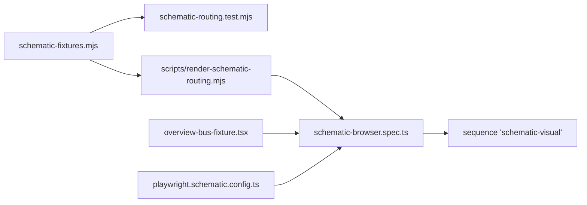

# `tests/visual/` — schematic wire routing

Tests for the schematic routing that draws connection wires around cards. They run
on fixed fixture diagrams with no database or server, so they are fast and exact.
The pure routing tests check geometry numbers; the browser spec renders the real
React overview component in Chromium.



## What's here

| Path | What it is |
| --- | --- |
| [`schematic-fixtures.mjs`](schematic-fixtures.mjs) | Fixture diagrams (cards and links), including a deliberately tangled "spaghetti" case. |
| [`schematic-routing.test.mjs`](schematic-routing.test.mjs) | `node:test` checks of `routeSchematicConnections` from the web package: no wires through cards or labels, every relationship kept, unplaced endpoints explained, search budgets respected, incoming branches share a trunk. |
| [`schematic-browser.spec.ts`](schematic-browser.spec.ts) | Renders the fixtures in Chromium and checks that labels and wires stay visible, and that bus targets select the nearest wire and keep keyboard focus. `@schematic-visual` |
| [`overview-bus-fixture.tsx`](overview-bus-fixture.tsx) | Mounts the real `OverviewBusLayer` component with small shared and separate bus routes for the browser spec. |
| [`playwright.schematic.config.ts`](playwright.schematic.config.ts) | Single-purpose Playwright config: Chromium, one worker, no retries, output in `test-artifacts/schematic-browser/`. |

## How to run

```bash
npm run test:schematic                                      # pure routing tests
npm run report:schematic -- --out test-artifacts/schematic  # render fixture SVGs to look at
node tests/run-unified.mjs --sequence schematic-visual      # browser spec
```

CI runs the first two in the "Lint & Type Check" job and the `schematic-visual`
sequence in the "Smoke Gate" job; the sequence is also in the `pr` and `full`
profiles.

Up: [`tests/`](../README.md)
